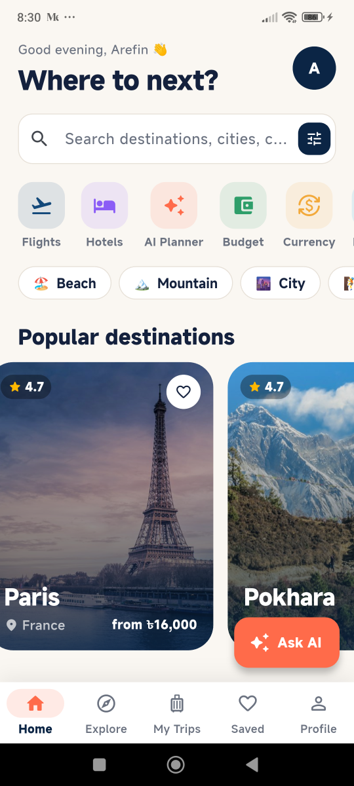
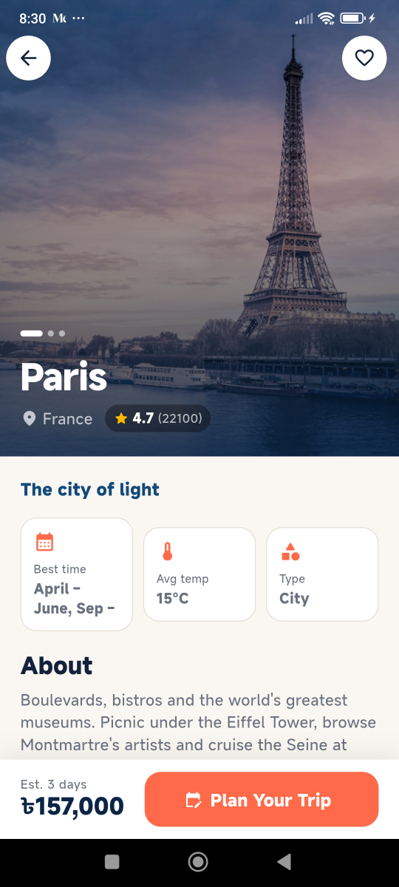
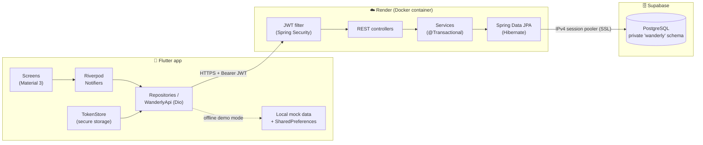

<div align="center">

# ✈️ Wanderly — Explore Beyond

**A full-stack travel planning app: Flutter mobile client, Spring Boot REST API, PostgreSQL on Supabase, deployed with Docker on Render.**

[](https://github.com/ayrinanwardev/SmartTravelApp/actions/workflows/ci.yml)


[Live API (Swagger)](https://wanderly-api-latest.onrender.com/swagger-ui.html) · [Backend docs](backend/README.md) · [Deployment guide](backend/DEPLOY.md)

</div>

---

## 📸 Screenshots

| Sign in | Home | Explore |
|:---:|:---:|:---:|
|  |  |  |
| **Destination details** | **Highlights & smart weather** | **My Trips** |
|  |  |  |

<sub>Captured on a Xiaomi Poco F3 (Android 13) running the release build against the live Render API.</sub>

---

## ✨ Features

| Area | What you can do |
|---|---|
| 🔐 **Accounts** | Sign up / sign in with JWT auth. The token is stored encrypted (Android Keystore / iOS Keychain), and the app signs you out automatically when it expires. |
| 🏠 **Home** | Personalised greeting, search, quick actions, popular and trending destinations, your next trip with a countdown, and recommendations based on your wishlist. |
| 🧭 **Explore** | Search by city or country; filter by category (beach, mountain, city, adventure, culture), max budget and best season; sort by rating or price. |
| 🏝️ **Destination details** | Photo gallery, highlights, best time to visit, a 5-day weather outlook with activity tips, a per-person cost estimate, attractions and reviews. |
| 🗓️ **Trip planner** | Pick destination, dates, travellers and budget, then build a day-by-day itinerary: add, edit, swipe-to-delete and **drag-to-reorder** activities. |
| 🏨 **Hotels & booking** | Hotel list with amenities and ratings; choose dates, guests and rooms, see a live price breakdown and get a confirmation code; booking history. |
| 💰 **Budget tracker** | Trip budget, expenses by category, pie and bar charts, and alerts at 80% used and when you go over. |
| 📔 **Travel journal** | Memories with photos (gallery or camera, uploaded to the server), location, date and albums. |
| ✨ **Trip assistant** | *"Plan a 4-day trip to Cox's Bazar under ৳20,000"* → itinerary, cost breakdown and tips, saved as a trip in one tap. |
| 🧰 **Tools** | Smart packing list (based on climate, trip length and domestic vs. abroad), BDT currency converter, flight search. |
| 👤 **Profile** | Trip, saved, memory and booking counts, notification preference, sign out. |

> **About the "AI" assistant:** it's a rule-based planner on the server. It parses the destination, number of days, travellers and budget (it understands "20k" and "2 lakh") and builds the plan from destination data. It sits behind an interface, so an LLM can replace it later without changing the API or the app. Weather, exchange rates and flight fares are simulated demo data.

---

## 🏗️ Technical architecture



### Mobile app — feature-first, layered

```
lib/
├── core/
│   ├── network/      Dio client + JWT interceptor, WanderlyApi (one method per endpoint),
│   │                 TokenStore (encrypted), RemoteSync mixin
│   ├── router/       GoRouter: bottom-tab shell + auth guard (redirects to /login)
│   ├── theme/        Material 3 theme, brand colours
│   └── widgets/      Shared UI (cards, image loader, error snackbars)
├── data/
│   ├── models/       Destination, Trip, Activity, Hotel, Booking, Expense, JournalEntry (+ JSON)
│   ├── repositories/ TravelRepository interface → ApiTravelRepository | MockTravelRepository
│   └── local/        LocalStore (SharedPreferences cache)
└── features/<feature>/
    ├── presentation/ Screens and widgets (UI only)
    └── providers/    Riverpod notifiers (state + logic)
```

- **Riverpod 3 notifiers own the state.** Screens only `watch` state and call notifier methods; derived providers (budget summary, trip by id, albums) recompute automatically.
- **Optimistic updates with rollback.** Deletes, reorders and the wishlist heart update the UI immediately. If the server call fails, the notifier reloads the server's data and the UI shows a readable error.
- **Two data modes, one UI.** API mode is the default; `--dart-define=USE_API=false` switches every notifier to bundled mock data with no screen changes, because they depend on interfaces.
- **Auth flow.** Login returns a JWT → saved in encrypted storage → added to every request by a Dio interceptor. A `401` signs the user out, and the GoRouter guard sends them to the login screen.

### Backend — Spring Boot 4.1 (Java 21)

```
backend/src/main/java/com/wanderly/api/
├── controller/   REST endpoints (validation only, no logic)
├── service/      Business logic + transactions, entity → DTO mapping
├── repository/   Spring Data JPA
├── domain/       JPA entities (14 tables)
├── dto/          Request/response records (JSON matches the Flutter models)
├── security/     JwtService (HS256) + JwtAuthenticationFilter
├── config/       SecurityConfig, CORS, OpenAPI, data seeder
└── exception/    ApiException + GlobalExceptionHandler (RFC 9457 problem+json)
```

- **About 40 REST endpoints:** auth, destinations, hotels, bookings, trips and itinerary, wishlist, budget, journal with photo upload, notifications, planner and tools. Full list in [backend/README.md](backend/README.md).
- **Ownership checks in every service:** a user can never read or change another user's trips, expenses or bookings; other users get a `404`.
- **Stateless JWT security**, BCrypt password hashing, Bean Validation on every request body, OpenAPI/Swagger UI.

### Data & infrastructure

- **Supabase PostgreSQL**, with all tables in a **private `wanderly` schema**, so Supabase's auto-generated public Data API can't reach them. Only the backend can read or write.
- **Docker:** multi-stage build (Maven → JRE 21 Alpine), runs as a non-root user, has a health check, contains no secrets, and was tested under a 512 MB memory cap.
- **Render** runs the image from Docker Hub. Secrets are set as Render environment variables.
- **CI (GitHub Actions):** Flutter analyze + tests, backend tests on H2, and a Docker image build on every push.

---

## 🧠 Engineering highlights

| Problem | What I did | Result |
|---|---|---|
| Home screen took **14.8 s** to load from the remote DB | Found an N+1 query pattern (gallery, attractions, reviews loaded per row) and enabled Hibernate batch fetching | **1.6 s** (≈ 9× faster) |
| Supabase's direct DB host is IPv6-only; Docker and Render are IPv4-only | Found the project's region and switched to Supabase's IPv4 session pooler | Works locally, in Docker and on Render |
| Supabase publishes the `public` schema through a public API key | Moved every table into a private schema | Data reachable only through the authenticated API |
| Token stored in plain-text SharedPreferences | Moved it to encrypted secure storage, with automatic migration of the old token | Existing users stay signed in |
| Unclear whether the app would fit Render's 512 MB limit | Ran the full end-to-end test suite against the container capped at 512 MB | ~311 MB used (61%), no out-of-memory kills |

---

## 🛠️ Tech stack

| Layer | Technology |
|---|---|
| Mobile | Flutter 3.50, Dart 3.14, Material 3 |
| State & navigation | Riverpod 3, GoRouter 18 |
| Networking & storage | Dio 5, flutter_secure_storage, SharedPreferences, cached_network_image |
| UI | fl_chart, image_picker |
| Backend | Spring Boot 4.1, Spring Security, Spring Data JPA (Hibernate 7), jjwt, springdoc-openapi |
| Database | PostgreSQL on Supabase (H2 for local dev and tests) |
| DevOps | Docker, Docker Hub, Render, GitHub Actions |
| Testing | flutter_test, JUnit 5, MockMvc, AssertJ |

---

## 🚀 Getting started

### Prerequisites
Flutter 3.50+, Java 21, and an Android device or emulator. Docker is optional.

### 1. Backend
```bash
cd backend
```
Quick start with an in-memory database (sample data + demo account):
```bash
mvnw.cmd spring-boot:run -Dspring-boot.run.profiles=dev
```
Or with Supabase: copy `.env.example` to `.env`, fill in your project's details, then run:
```bash
mvnw.cmd spring-boot:run -Dspring-boot.run.profiles=supabase
```
API docs: http://localhost:8080/swagger-ui.html · Demo login: `demo@wanderly.app` / `wanderly123`

### 2. Mobile app
```bash
flutter pub get
```
```bash
flutter run
```

| Build | Talks to |
|---|---|
| `flutter run` (debug) | Local backend: `10.0.2.2:8080` on the Android emulator, `localhost` elsewhere |
| `flutter build apk --release` | Live API on Render |
| `--dart-define=API_URL=http://<PC-IP>:8080` | Any backend (e.g. a real phone on the same Wi-Fi) |
| `--dart-define=USE_API=false` | Offline demo mode (no backend) |

### 3. Deploy
Docker → Docker Hub → Render, step by step: **[backend/DEPLOY.md](backend/DEPLOY.md)**.

---

## 🧪 Testing

```bash
flutter test
```
```bash
cd backend && mvnw.cmd test
```

- **Flutter (11 tests):** the planner's parsing (days, travellers, "20k", "2 lakh"), JSON parsing of real API payloads, wishlist, activity reordering, budget alerts, and token storage on sign-in/sign-out.
- **Backend (12 tests):** full-stack integration tests (real Spring context, H2, JWT). They cover the catalogue and filters, 401 without a token, login, duplicate sign-up, the trip lifecycle including reorder and cross-user isolation, saving a planner result as a trip, booking prices, budget alerts, notifications, tools and the OpenAPI docs.

---

## ⚠️ Known limitations & roadmap

- Journal photos are stored on the container's disk and are wiped when Render redeploys → move them to Supabase Storage.
- Render's free plan sleeps after 15 minutes idle, so the first request can take about a minute.
- Weather, exchange rates and flight fares are simulated → connect live APIs.
- Next: Flyway migrations, Google Maps screen, an LLM-backed trip assistant, group trips with expense splitting, push notifications (FCM).

---

<div align="center">

Built by **[@ayrinanwardev](https://github.com/ayrinanwardev)**

</div>
