<div align="center">

# ✈️ Wanderly — Explore Beyond

**A full-stack, real-time travel app: Flutter (Dart) client, Kotlin + Spring Boot API with WebSockets, SSLCommerz payments, live location sharing and push notifications, on Supabase PostgreSQL, deployed with Docker on Render.**

[](https://github.com/ayrinanwardev/SmartTravelApp/actions/workflows/ci.yml)


[Live API (Swagger)](https://wanderly-api-latest.onrender.com/swagger-ui.html) · [Backend docs](backend/README.md) · [Deployment guide](backend/DEPLOY.md)

</div>

---

## 🎬 Demo

Recorded on a real phone (Xiaomi Poco F3, Android 13) with the release build. The API runs from the **production Docker image** (`ayrinanwardev/wanderly-api:2.0.1`, capped at 512 MB like Render's free plan) against Supabase PostgreSQL. The phone reaches it through `adb reverse`. The trip companions "Rafi" and "Nadia" are test accounts, driven by a script over the same WebSocket API the app uses.

| Maps | Live group trip | SSLCommerz payment | Notifications |
|:---:|:---:|:---:|:---:|
| 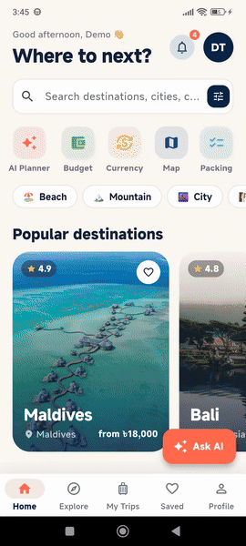 | 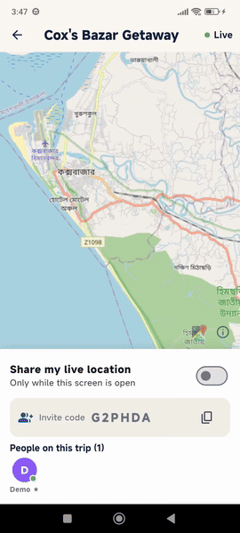 | 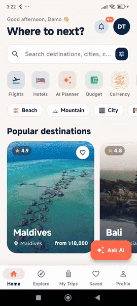 | 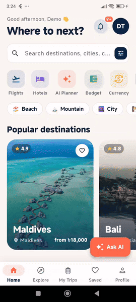 |
| All destinations on OpenStreetMap; attraction and hotel pins per destination | Friends join with a code, walk along Cox's Bazar beach live, and add an activity that appears instantly | Booking → SSLCommerz sandbox (bKash) → validated by the server → paid | Live notification centre, unread badge, in-app alerts and a system notification while the app is in the background |

▶️ **Full walkthrough (3:01, MP4):** [docs/demo/wanderly-demo.mp4](docs/demo/wanderly-demo.mp4)

<sub>The background system-notification clip comes from an earlier run of the same build against the Kotlin API outside Docker. Everything else in the video is the Docker run.</sub>

---

## 📸 Screenshots

| Sign in | Home | Explore |
|:---:|:---:|:---:|
| 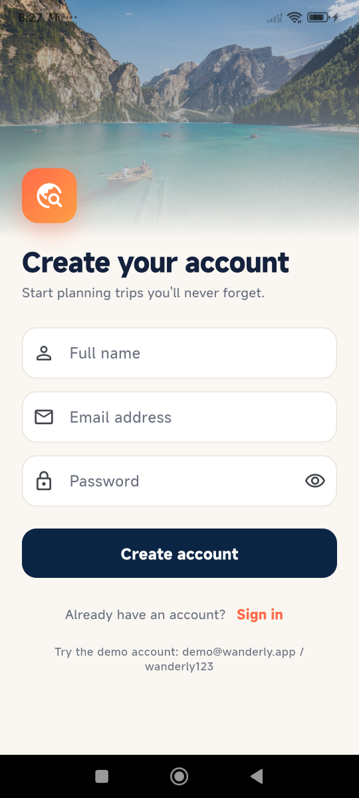 |  | 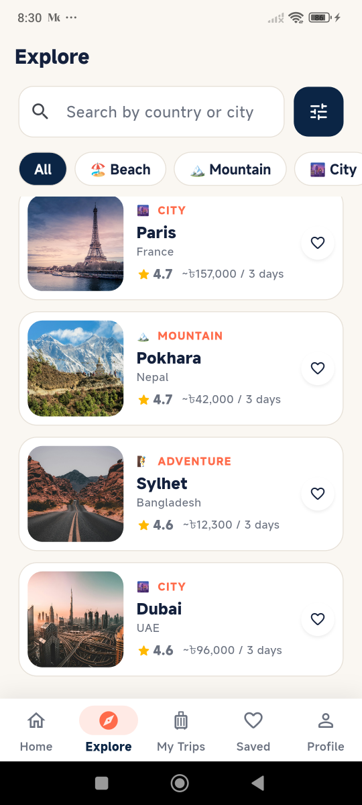 |
| **Destination details** | **Highlights & smart weather** | **My Trips** |
|  | 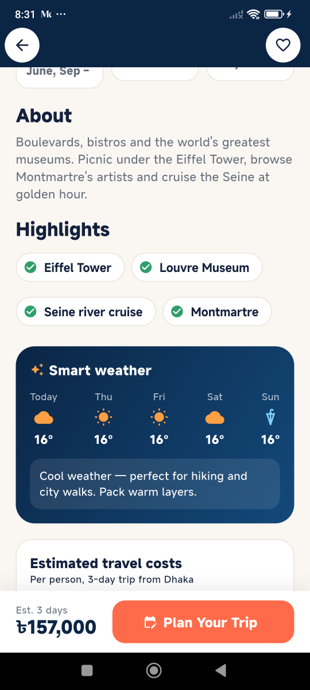 | 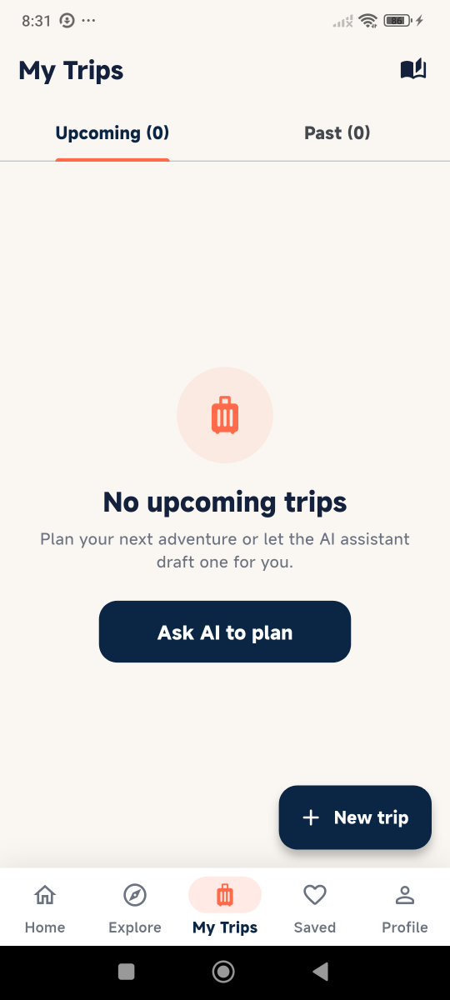 |

<sub>Captured on a Xiaomi Poco F3 (Android 13) running the release build against the live Render API.</sub>

---

## ✨ Features

| Area | What you can do |
|---|---|
| 🔐 **Accounts** | Sign up / sign in with JWT auth. The token is stored encrypted (Android Keystore / iOS Keychain), and the app signs you out automatically when it expires. |
| 🏠 **Home** | Personalised greeting, search, quick actions, popular and trending destinations, your next trip with a countdown, and recommendations based on your wishlist. |
| 🧭 **Explore** | Search by city or country; filter by category (beach, mountain, city, adventure, culture), max budget and best season; sort by rating or price. |
| 🏝️ **Destination details** | Photo gallery, highlights, best time to visit, a 5-day weather outlook with activity tips, a per-person cost estimate, attractions and reviews. |
| 🗓️ **Trip planner** | Pick destination, dates, travellers and budget, then build a day-by-day itinerary: add, edit, swipe-to-delete and **drag-to-reorder** activities. |
| 🏨 **Hotels & booking** | Hotel list with amenities and ratings; choose dates, guests and rooms, see a live price breakdown and get a confirmation code; booking history with payment status. |
| 💳 **Payments (SSLCommerz)** | Pay for a booking with bKash, Nagad, Rocket or cards through SSLCommerz's hosted checkout (in-app WebView). The server **re-validates every payment with SSLCommerz** (amount, currency, transaction id) before marking it paid, so a forged callback can't confirm a booking. |
| 👥 **Group trips (live sync)** | Share a trip with a 6-character code; friends join and edit the same itinerary. Every change reaches the other members instantly over WebSockets, along with "X joined your trip" alerts and online indicators. |
| 📍 **Live location & maps** | OpenStreetMap maps of destinations, attractions and hotels with "my location" and Google Maps directions. On a group trip, members can share their live location and see each other move on the map in real time. |
| 🔔 **Notifications** | In-app notification centre with unread badge, updated live over the WebSocket; system notifications for bookings, payments and companions; Firebase Cloud Messaging push when the app is closed. |
| 💰 **Budget tracker** | Trip budget, expenses by category, pie and bar charts, and alerts at 80% used and when you go over. |
| 📔 **Travel journal** | Memories with photos (gallery or camera, uploaded to the server), location, date and albums. |
| ✨ **Trip assistant** | *"Plan a 4-day trip to Cox's Bazar under ৳20,000"* → itinerary, cost breakdown and tips, saved as a trip in one tap. |
| 🧰 **Tools** | Smart packing list (based on climate, trip length and domestic vs. abroad), BDT currency converter, flight search. |
| 👤 **Profile** | Trip, saved, memory and booking counts, notification preference, sign out. |

> **About the "AI" assistant:** it's a rule-based planner on the server. It parses the destination, number of days, travellers and budget (it understands "20k" and "2 lakh") and builds the plan from destination data. It sits behind an interface, so an LLM can replace it later without changing the API or the app. Weather, exchange rates and flight fares are simulated demo data.

---

## 🏗️ Technical architecture

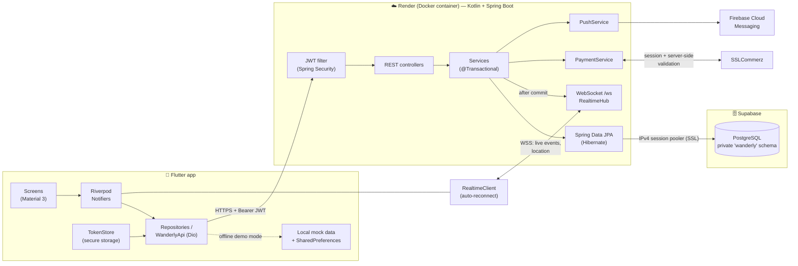

### Real-time events

The app keeps one authenticated WebSocket (`/ws?token=<JWT>`) open while signed in. Events are published **only after the database transaction commits**, so clients never see a change that later rolls back.

| Event | When |
|---|---|
| `notification.created` | Any new notification (booking, payment, companion joined, budget alert) |
| `trip.updated` / `trip.deleted` | A member changes or deletes a shared trip |
| `trip.member_joined` | Someone joins with the share code |
| `booking.updated` | A payment succeeds or fails |
| `location.updated` / `location.snapshot` / `location.stopped` | Live location on a group trip |

### Live location sharing

Positions travel only over the WebSocket and are kept **in memory** on the server, never written to the database. Sharing is opt-in per trip and stops when the member leaves the screen or disconnects.

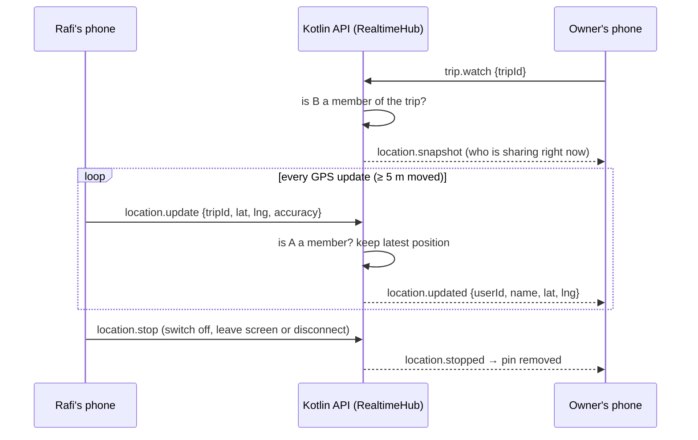

### Payment flow (SSLCommerz)

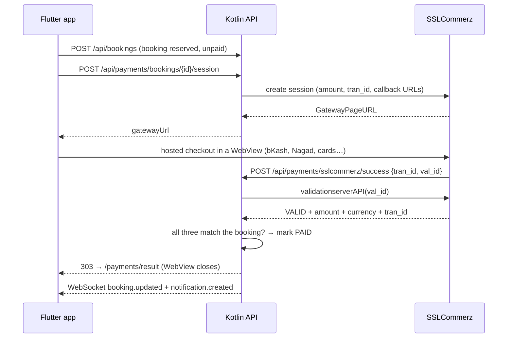

A forged or replayed callback fails the validation step, and the booking is marked `failed` instead of paid. The IPN endpoint goes through the same validation, so a payment is confirmed even if the user closes the app during checkout.

### Mobile app — feature-first, layered

```
lib/
├── core/
│   ├── network/      Dio client + JWT interceptor, WanderlyApi (one method per endpoint),
│   │                 TokenStore (encrypted), RemoteSync mixin,
│   │                 RealtimeClient (WebSocket, auto-reconnect with backoff, heartbeat)
│   ├── location/     LocationService (permissions, current position, position stream)
│   ├── notifications/ Local notifications + Firebase Cloud Messaging registration
│   ├── router/       GoRouter: bottom-tab shell + auth guard (redirects to /login)
│   ├── theme/        Material 3 theme, brand colours
│   └── widgets/      Shared UI (cards, image loader, error snackbars)
├── data/
│   ├── models/       Destination, Trip, Activity, Hotel, Booking (+ payment status), Expense,
│   │                 JournalEntry, AppNotification, TripMember, MemberLocation (+ JSON)
│   ├── repositories/ TravelRepository interface → ApiTravelRepository | MockTravelRepository
│   └── local/        LocalStore (SharedPreferences cache)
└── features/<feature>/
    ├── presentation/ Screens and widgets (UI only)
    └── providers/    Riverpod notifiers (state + logic)
```

- **Riverpod 3 notifiers own the state.** Screens only `watch` state and call notifier methods; derived providers (budget summary, trip by id, albums) recompute automatically.
- **Optimistic updates with rollback.** Deletes, reorders and the wishlist heart update the UI immediately. If the server call fails, the notifier reloads the server's data and the UI shows a readable error.
- **Two data modes, one UI.** API mode is the default; `--dart-define=USE_API=false` switches every notifier to bundled mock data with no screen changes, because they depend on interfaces.
- **Auth flow.** Login returns a JWT → saved in encrypted storage → added to every request by a Dio interceptor. A `401` signs the user out, and the GoRouter guard sends them to the login screen.
- **One real-time connection.** `realtimeProvider` opens the WebSocket when a user signs in and closes it on sign-out. `realtimeSyncProvider` routes events to the right notifier: new notifications, a trip reload, or a booking's payment status. It shows a snackbar in the foreground and a system notification in the background. Screens such as Live trip subscribe to the same stream.
- **New feature screens:** `map/` (OpenStreetMap via flutter_map, pins, distance, directions), `trips/live_trip_screen` (members, invite code, live locations), `hotels/payment_screen` (WebView checkout that catches the `/payments/result` redirect), `notifications/` (notification centre and bell badge).

### Backend — Kotlin 2.3 + Spring Boot 4.1 (JVM 21)

```
backend/src/main/kotlin/com/wanderly/api/
├── controller/   REST endpoints (validation only, no logic) + payment callbacks
├── service/      Business logic + transactions, entity → DTO mapping
├── realtime/     WebSocket handler, JWT handshake, RealtimeHub, after-commit publisher
├── payment/      PaymentGateway interface → SslCommerzGateway, PaymentService
├── repository/   Spring Data JPA
├── domain/       JPA entities (15 entities)
├── dto/          Request/response data classes (JSON matches the Flutter models)
├── security/     JwtService (HS256) + JwtAuthenticationFilter
├── config/       SecurityConfig, CORS, OpenAPI, data seeder, map-coordinate backfill
└── exception/    ApiException + GlobalExceptionHandler (RFC 9457 problem+json)
```

- **About 50 REST endpoints** plus the WebSocket: auth, destinations, hotels, bookings and payments, trips and itinerary, group-trip sharing, wishlist, budget, journal with photo upload, notifications, device registration, planner and tools. Full list in [backend/README.md](backend/README.md).
- **Access checks in every service:** a user can only reach their own data and the trips they are a member of; others get a `404`. Only a trip's owner can share or delete it. WebSocket messages are checked the same way.
- **Payment safety:** callbacks from the browser are never trusted. The server asks SSLCommerz to validate each `val_id` and checks amount, currency and transaction id before marking a booking paid.
- **Stateless JWT security**, BCrypt password hashing, Bean Validation on every request body, OpenAPI/Swagger UI.

### Data & infrastructure

- **Supabase PostgreSQL**, with all tables in a **private `wanderly` schema**, so Supabase's auto-generated public Data API can't reach them. Only the backend can read or write.
- **Docker:** multi-stage build (Maven → JRE 21 Alpine), runs as a non-root user, has a health check, contains no secrets, and was tested under a 512 MB memory cap.
- **Render** runs the image from Docker Hub. Secrets are set as Render environment variables.
- **CI (GitHub Actions):** Flutter analyze + tests, backend tests on H2, and a Docker image build on every push.

---

## 🧠 Engineering highlights

| Problem | What I did | Result |
|---|---|---|
| Home screen took **14.8 s** to load from the remote DB | Found an N+1 query pattern (gallery, attractions, reviews loaded per row) and enabled Hibernate batch fetching | **1.6 s** (≈ 9× faster) |
| Supabase's direct DB host is IPv6-only; Docker and Render are IPv4-only | Found the project's region and switched to Supabase's IPv4 session pooler | Works locally, in Docker and on Render |
| Supabase publishes the `public` schema through a public API key | Moved every table into a private schema | Data reachable only through the authenticated API |
| Token stored in plain-text SharedPreferences | Moved it to encrypted secure storage, with automatic migration of the old token | Existing users stay signed in |
| Unclear whether the app would fit Render's 512 MB limit | Ran the full end-to-end test suite against the container capped at 512 MB | ~311 MB used (61%), no out-of-memory kills |
| Payment "success" redirects come from the user's browser and could be forged | Never trust the callback: the server validates every `val_id` with SSLCommerz and matches amount, currency and transaction id | Forged callback test → booking marked `failed`, not paid |
| A live event could announce a change whose transaction later rolls back | Events are queued with `afterCommit` and sent only once the database commit succeeds | Clients never see phantom updates |
| Supabase's pooler silently closed idle DB connections, failing the next request | Shorter Hikari `keepalive-time` (60 s) and `max-lifetime` (5 min) | Connections are recycled before the pooler drops them |

---

## 🛠️ Tech stack

| Layer | Technology |
|---|---|
| Mobile | Flutter 3.50, Dart 3.14, Material 3 |
| State & navigation | Riverpod 3, GoRouter 18 |
| Networking & storage | Dio 5, flutter_secure_storage, SharedPreferences, cached_network_image |
| UI | fl_chart, image_picker |
| Maps, location, real-time | flutter_map (OpenStreetMap), geolocator, web_socket_channel, webview_flutter |
| Notifications | firebase_messaging (FCM), flutter_local_notifications |
| Backend | Kotlin 2.3, Spring Boot 4.1, Spring Security, Spring WebSocket, Spring Data JPA (Hibernate 7), jjwt, Firebase Admin SDK, springdoc-openapi |
| Payments | SSLCommerz (bKash, Nagad, Rocket, cards) |
| Database | PostgreSQL on Supabase (H2 for local dev and tests) |
| DevOps | Docker, Docker Hub, Render, GitHub Actions |
| Testing | flutter_test, JUnit 5, MockMvc, AssertJ |

---

## 🚀 Getting started

### Prerequisites
Flutter 3.50+, JDK 21 (the Maven wrapper downloads Kotlin), and an Android device or emulator. Docker is optional.

### 1. Backend
```bash
cd backend
```
Quick start with an in-memory database (sample data + demo account):
```bash
mvnw.cmd spring-boot:run -Dspring-boot.run.profiles=dev
```
Or with Supabase: copy `.env.example` to `.env`, fill in your project's details, then run:
```bash
mvnw.cmd spring-boot:run -Dspring-boot.run.profiles=supabase
```
API docs: http://localhost:8080/swagger-ui.html · Demo login: `demo@wanderly.app` / `wanderly123`

### 2. Mobile app
```bash
flutter pub get
```
```bash
flutter run
```

| Build | Talks to |
|---|---|
| `flutter run` (debug) | Local backend: `10.0.2.2:8080` on the Android emulator, `localhost` elsewhere |
| `flutter build apk --release` | Live API on Render |
| `--dart-define=API_URL=http://<PC-IP>:8080` | Any backend (e.g. a real phone on the same Wi-Fi) |
| `--dart-define=USE_API=false` | Offline demo mode (no backend) |

### 3. Deploy
Docker → Docker Hub → Render, step by step: **[backend/DEPLOY.md](backend/DEPLOY.md)**.

---

## 🧪 Testing

```bash
flutter test
```
```bash
cd backend && mvnw.cmd test
```

- **Flutter (11 tests):** the planner's parsing (days, travellers, "20k", "2 lakh"), JSON parsing of real API payloads, wishlist, activity reordering, budget alerts, and token storage on sign-in/sign-out.
- **Backend (15 tests):** full-stack integration tests (real Spring context, H2, JWT). They cover the catalogue with map coordinates, 401 without a token, login, duplicate sign-up, the trip lifecycle, group trips (share, join, member permissions), payments (session, valid callback, **forged callback rejected**), the planner, budget alerts, notifications and devices, tools and the OpenAPI docs. A separate test starts a real server and connects real WebSocket clients: handshake refused without a token, live notifications, member-joined, location sharing and snapshots, outsider rejection, trip updates.

---

### On-device test (Xiaomi Poco F3, Android 13, release build, API in Docker)

| Feature | How it was tested | Result |
|---|---|---|
| Map of all destinations, pin cards, directions | Tapped pins on the world map | ✅ |
| Destination map with attraction and hotel pins and filters | Sajek Valley → View on map, toggled the filter chips | ✅ |
| Group trip: join by code | Two scripted companions joined with the invite code | ✅ members list 1 → 3 instantly, "joined" alerts |
| Live location of companions | Companions walked along Cox's Bazar beach over the WebSocket | ✅ pins move in real time |
| Sharing the phone's own GPS location | Switched on "Share my live location"; a companion listened on the socket | ✅ received; switching off sent `location.stopped` |
| Live itinerary sync | A companion added an activity | ✅ appeared on the owner's phone without refresh |
| SSLCommerz payment | Booked a hotel and paid in the sandbox with bKash | ✅ server-validated, booking shows **Paid · BKash** |
| In-app and system notifications | Events while the app was open and in the background | ✅ snackbar, badge, notification centre, system notification |
| Firebase push with the app fully closed | Needs a Firebase project (`google-services.json`) | ⏳ not yet configured |

The container used 375–412 MB of its 512 MB limit during the run, with no out-of-memory kills. A scripted end-to-end check (`dart`, against the Kotlin API on Supabase and against the Docker image) also covers: invalid-token WebSocket refusal, location snapshots, a **forged payment callback being rejected**, fresh transaction ids on retry, and clean-up.

---

## ⚠️ Known limitations & roadmap

- Journal photos are stored on the container's disk and are wiped when Render redeploys → move them to Supabase Storage.
- Render's free plan sleeps after 15 minutes idle, so the first request can take about a minute.
- Weather, exchange rates and flight fares are simulated → connect live APIs.
- Payments run against the **SSLCommerz sandbox** (`testbox`); live payments need a merchant account.
- Push notifications need your own Firebase project (`google-services.json` + `FIREBASE_CREDENTIALS_BASE64`). Without it, notifications still arrive in real time while the app is open or in the background, but not after the app has been closed.
- Live connections are kept in one server's memory → use a Redis pub/sub broker to run more than one instance.
- Next: Flyway migrations, an LLM-backed trip assistant, expense splitting for group trips.

---

<div align="center">

Built by **[@ayrinanwardev](https://github.com/ayrinanwardev)**

</div>
